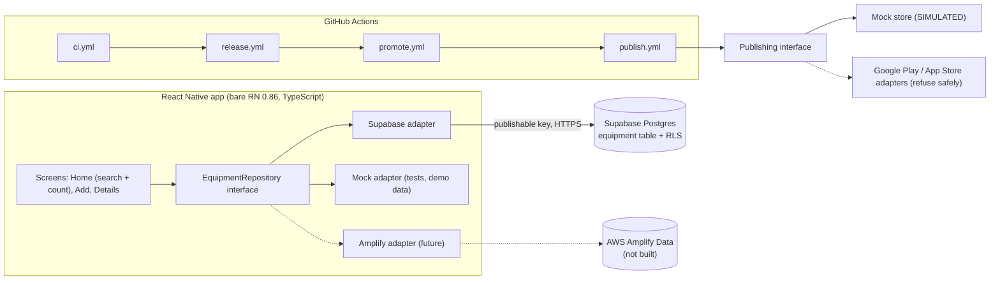
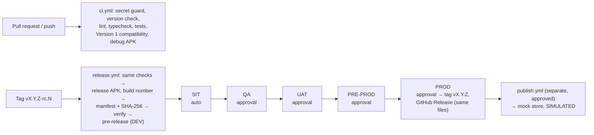

# equipDemo: mobile CI/CD proof of concept (presentation pack)

Status as of **21 Oct 2026**. Every figure below comes from a run, release or file in this repository;
nothing is estimated unless it says so. The demo script is in [DEMO_SCRIPT.md](DEMO_SCRIPT.md).

**Labels used throughout**

| Label | Meaning |
|---|---|
| **IMPLEMENTED** | Built in this repository **and** executed; evidence linked |
| **SIMULATED** | Runs for real, but stands in for something that doesn't exist here (an environment, a store); always labelled in its output |
| **DOCUMENTED** | Designed and written down; **not built or not run** |
| **NOT COMPLETED** | Attempted or required, but not finished; the reason is stated |

Run numbers refer to `https://github.com/keerthanarameshdasari-hub/equipment-demo-app/actions/runs/<run>`.

---

## 1. System architecture

| Component | Status | Evidence |
|---|---|---|
| Bare React Native app, Expo removed | **IMPLEMENTED** | BASELINE.md; `v1.1.0` |
| Supabase table with row-level security (read and insert only; no update or delete) | **IMPLEMENTED** | SUPABASE.md; live integration tests 4/4 in SIT/PRE-PROD |
| UI depends only on the repository interface (lint-enforced seam) | **IMPLEMENTED** | `__tests__/architecture.test.js`, `repositoryContract.test.ts` |
| AWS Amplify backend and adapter | **DOCUMENTED** | AWS_MIGRATION.md (contract, plan); no AWS backend exists |
| Publishing adapter: interface, mock store | **IMPLEMENTED** / mock **SIMULATED** | PUBLISHING.md; publish runs 39593358889, 39593535094 |
| Real Google Play / App Store integration | **NOT COMPLETED** (out of scope: no store accounts). Adapters exist and refuse safely | `scripts/publish/adapters/store.js` |
| iOS build in CI | **NOT COMPLETED** (no macOS runner set up, no Apple account). iOS version numbers are recorded in each manifest | RELEASES.md §2 |

## 2. CI/CD workflow

| Capability | Status | Evidence |
|---|---|---|
| CI on every PR and push (7 workflows in `.github/workflows`) | **IMPLEMENTED** | Latest `main` CI 39623473206 green |
| Release candidates built only from RC tags; identity read back from the APK | **IMPLEMENTED** | `v1.1.1-rc.1`, `v1.1.2-rc.1`, `v2.0.0-rc.1` |
| Promotion without rebuilding (SHA-256 checked at every stage) | **IMPLEMENTED** | `release-record.json` on `v1.1.2` and `v2.0.0` |
| Pinned action SHAs, Dependabot, `actionlint` in CI | **IMPLEMENTED** | `ci.yml`; Dependabot PRs #4, #5 open |
| Failure annotations (Gradle cause, Jest summary on the run page) | **IMPLEMENTED** | `.github/scripts/run-annotated.sh` |

## 3. Version 1 baseline and release record

| Item | Value | Status |
|---|---|---|
| Original Expo app preserved | tag `v1.0.0`, branch `release/v1`; it built in run 39149426936 before any change | **IMPLEMENTED** |
| Version 1 (bare RN, same features) | tag `v1.1.0` | **IMPLEMENTED** |
| First release through the pipeline | `v1.1.1`, build **1031** (earlier two-stage scheme) | **IMPLEMENTED** |
| Version 1 through all six stages | `v1.1.2`, build **1041**, commit `21ee51e` | **IMPLEMENTED** |
| Version 1 binary | `equipdemo-v1.1.2-rc.1-build1041.apk`, SHA-256 `c99634e4…c9fc0`, identical in every stage | **IMPLEMENTED** |
| Stages recorded | DEV (actual) → SIT → QA → UAT → PRE-PROD (simulated) → PROD (actual), 15:13–16:07 UTC, 20 Oct | **IMPLEMENTED** |
| Approver | repository owner in every role (demo; "prevent self-review" off) | **SIMULATED** team roles |

## 4. Version 2 update and regression evidence

Version 2 (`2.0.0`) = Version 1 plus **search with a result count**. No dependency, API or schema change
(VERSION2.md §2).

| Evidence | Result | Status |
|---|---|---|
| Version 1's own tests on Version 1 (`v1.1.2`) | 53 passed, 0 failed | **IMPLEMENTED** |
| Version 1's tests against Version 2 code (backward compatibility) | 53 passed, 0 failed | **IMPLEMENTED** |
| Version 2 suite incl. `search.test.tsx` and `regression.v1.test.tsx` | 92 passed at release (119 on `main` today) | **IMPLEMENTED** |
| Live Supabase read/write at the Version 2 commit | passed in SIT and PRE-PROD | **IMPLEMENTED** (SIT/PRE-PROD environments **SIMULATED**) |
| Released | `v2.0.0`, build **1052**, SHA-256 `fd0736d1…2d93`, six stages | **IMPLEMENTED** |
| Version 1 untouched | `v1.1.2` release and record unchanged | **IMPLEMENTED** |

Two incidents on the way, both fixed without changing the binary: a corrupted NDK download (PR #10,
explicit install with retries; the failed attempt is why the build is 1052, not 1051) and an HTTP 403 when
PROD tried to create the tag (PR #11, tag first, resumable PROD).

## 5. Six-stage environment matrix

| Stage | Kind | Approval | Checks (real in every stage) | Backend target |
|---|---|---|---|---|
| DEV | **IMPLEMENTED** (actual) | automatic | guard, version, lint, typecheck, tests, APK build | none (mock data) |
| SIT | environment **SIMULATED** | automatic | integrity; live Supabase integration (read, write, RLS, constraints) | shared demo Supabase |
| QA | **SIMULATED** (no device farm) | required | integrity; full test suite; APK inspection; sign-off notes | none |
| UAT | **SIMULATED** (no user group) | required | integrity; acceptance notes | none |
| PRE-PROD | environment **SIMULATED** | required | integrity; backend readiness | shared demo Supabase |
| PROD | **IMPLEMENTED** (actual internal release) | required | integrity; read-only smoke check | shared demo Supabase |

- Per-environment variables and secrets: **IMPLEMENTED** (GitHub Environments, deployment branch `main`).
- A failed check blocks the next stage: **IMPLEMENTED** (runs 39452948125 → 39453228222).
- Separate Supabase projects per stage: **NOT COMPLETED** (one free project; that's why SIT/PRE-PROD are simulated).
- Note: backend config is fixed at build time, so stage variables change the *checks*, not an installed app (STAGES.md).

## 6. Version and build numbering policy

| Channel | App ID | Version | Build number (Android versionCode) | Status |
|---|---|---|---|---|
| Development (CI) | `com.equipmentdemo.app.dev` | `X.Y.Z-dev.<run>` | CI run number | **IMPLEMENTED** |
| Release candidate | `com.equipmentdemo.app` | `X.Y.Z` | `1000 + run × 10 + attempt`, checked to be higher than every existing release | **IMPLEMENTED** (1031, 1041, 1052) |
| Approved release | same | same | same binary, no rebuild | **IMPLEMENTED** |
| CodeBuild comparison | same | same | `5000 + CodeBuild build number` (never promoted) | **IMPLEMENTED** (5003) |
| EAS comparison | same | same | `6001` (never promoted) | **NOT COMPLETED** (see §9) |
| iOS `CFBundleVersion` | — | — | same build number, recorded in the manifest | **DOCUMENTED** |

The single source of truth for the version is `package.json`. `npm run version:set` changes it everywhere,
and CI fails if Android, iOS and `package.json` disagree.

## 7. Secrets and IAM design

| Item | Status | Detail |
|---|---|---|
| Only the Supabase **publishable** key, in environment secrets; service-role key stored nowhere | **IMPLEMENTED** | SECRETS.md |
| Bundle allow-list (only `SUPABASE_URL`, `SUPABASE_PUBLISHABLE_KEY` can be inlined) | **IMPLEMENTED** | test fails if the list grows |
| Secret-file guard (`.env`, keystores, keys) in CI and CodeBuild | **IMPLEMENTED** | `ci.yml`, CodeBuild template |
| No secrets for fork PRs; no `pull_request_target` | **IMPLEMENTED** | workflow triggers |
| Masking: values never printed; AWS values `::add-mask::` | **IMPLEMENTED** | `secrets-demo.yml` |
| AWS via GitHub OIDC (15-minute credentials, one-secret IAM role) | **NOT COMPLETED**: the role and secret were created, but an AWS Organizations SCP denies creating the OIDC provider. Long-lived keys were deliberately **not** used instead | SECRETS.md "Result" |
| CodeBuild service role: logs and one S3 bucket only; bucket encrypted, private, 30-day expiry | **IMPLEMENTED** | `aws/codebuild-comparison.yaml` |
| Store credentials, passed only if `REAL_PUBLISHING_ENABLED=true` | **DOCUMENTED** (no store accounts) | PUBLISHING.md |
| Release signing | **SIMULATED**: release APKs are signed with the Android **debug key** (internal only). A real upload key / Play App Signing is **NOT COMPLETED** | RELEASES.md §7 |

## 8. Failure, recovery and rollback

| Scenario | Result | Status |
|---|---|---|
| Failing test → CI red, release blocked (no APK) | runs 39587402651, 39587402672 | **IMPLEMENTED** |
| Fix → green again | 39587545196, 39587538049 | **IMPLEMENTED** |
| App regression (count off by one) caught by 4 tests | 39588864703 | **IMPLEMENTED** |
| Recover from the known-good tag → green | 39589023673 | **IMPLEMENTED** (finding: also undid later good changes; runbook now prefers `git revert`) |
| Tampered APK (one extra byte) rejected by verification and publishing | 39593348460 | **IMPLEMENTED** |
| Production publish rejected by reviewer → nothing runs | 39593535094 | **IMPLEMENTED** (publishing itself **SIMULATED**) |
| Known-good releases intact and traceable (v1.1.1, v1.1.2, v2.0.0) | 39593351937 | **IMPLEMENTED** |
| App rollback = roll forward with a higher build number | RUNBOOK-ROLLBACK.md Path A | **DOCUMENTED** (steps drilled up to source recovery; a v2.0.1 release was not made) |
| Halting a store staged rollout | runbook | **DOCUMENTED** (no store) |
| Backend rollback (Supabase schema, backups / point-in-time recovery) | runbook Path B | **DOCUMENTED** (not exercised) |

## 9. Three CI/CD platforms

Same commits on every platform: `63b549e` (should pass) and `44ff925` (deliberately failing test).
Details: [PLATFORM_COMPARISON.md](PLATFORM_COMPARISON.md).

| | GitHub Actions | AWS CodeBuild | EAS Workflows |
|---|---|---|---|
| Status | **IMPLEMENTED** (baseline) | **IMPLEMENTED** (comparison only) | **NOT COMPLETED** (trial in progress) |
| Passing commit | ✅ release build 1081, run 39596119673 | ✅ build 3 (5003): 119/119 tests, checksum `OK`, mock gate held | 1st run: checks ✅, **build failed** (`android.package` missing for GitHub-triggered builds); fixed on the trial branch, rerun pending |
| Failing commit | ✅ stopped at the drill test (checks job 38 s) | ✅ stopped at the same test (49 s) | not yet run |
| Working time, passing run | 8 min 04 s (+ ~5 min queued) | ~9 min 29 s | not measured |
| Gradle build | 5 min 00 s (Gradle cache configured) | 7 min 44 s (no cache) | not measured |
| Failed runs and why | — | build 1 (exit 141), our script's bug, fixed in PR #19 | run 1: config required by EAS for bare RN |
| Approvals | Environments, required reviewers (**IMPLEMENTED**) | none in CodeBuild alone; CodePipeline (**DOCUMENTED**) | `require-approval` job: in the trial workflow, **not yet run** |
| Setup | workflow files in the repo | CloudFormation stack (role, bucket, logs, project); manual start per build | EAS CLI, `eas init`, GitHub connection, `eas.json`, `android.package`; Expo SDK version warning (no `expo` package) |
| Cost here | free (public repo) | ~20 build-minutes on medium (exact charge: AWS Billing, not yet read) | free plan; build quota and queue not yet measured |

**Decision:** keep GitHub Actions as the primary platform; consider CodeBuild for AWS-native steps once the
Amplify backend exists. **No speed or safety claim**: one passing sample per platform, different memory
(16 GB vs 7 GB), caches, JDK vendor and region. The EAS column will be completed from its runs; EAS stays on
the trial branches only (AGENTS.md keeps EAS configuration out of `main`).

## 10. Scaling, load balancing and monitoring

| Capability | Status |
|---|---|
| CI/CD monitoring report (outcomes, durations, failing steps, artifacts), weekly and on demand | **IMPLEMENTED**: run 39593355251, snapshot `evidence/ci-report-2026-10-21.md` (97 runs: 78 succeeded, 14 failed) |
| App crash reporting (no personal data, tied to build number) | **DOCUMENTED** (OPERATIONS.md §3); no SDK in the app |
| Backend monitoring | Supabase's built-in dashboard only; AWS CloudWatch/X-Ray **DOCUMENTED** |
| Load balancing, autoscaling, failover tests | **DOCUMENTED** test plan only (OPERATIONS.md §7). **Not tested.** Supabase is the active backend, so no AWS scaling claim is made |
| Load testing | **NOT COMPLETED** (planned against PRE-PROD after migration) |

## 11. Risks, limitations and next steps

| Risk / limitation | Effect | Next step |
|---|---|---|
| One shared Supabase project | SIT/PRE-PROD aren't isolated; tests write to the same table | Separate Supabase projects (or Amplify branches) per stage |
| Debug-key signing | Releases are internal only | Upload key as an environment secret + Play App Signing |
| One person in every approver role | Approvals show the mechanism, not segregation of duties | Different reviewers per environment; enable "prevent self-review" |
| AWS OIDC blocked by an organization policy | No CI access to AWS from GitHub | Org admin creates the GitHub provider or exempts the account |
| No iOS build | Half of the mobile pipeline untested | macOS runner (GitHub or EAS) once an Apple account exists |
| Records are editable by repository admins | Not tamper-evident | Signed provenance (artifact attestations) |
| Build-time backend configuration | One binary can't switch backends per stage | Runtime configuration, if per-stage backends are needed |
| Platform comparison has 1 passing sample each, cold caches on CodeBuild | Runtime numbers aren't a benchmark | Caches + ≥5 runs each; finish the EAS trial |
| Insert is open to anyone with the app (no sign-in) | Spam possible in a real deployment | Auth + `authenticated` insert policy + rate limiting |
| A latent flaky step went unseen (exit 141) | Could fail any release by chance | Fixed (PR #19); running on a second platform found it |

**Next steps, in order:** (1) finish the EAS runs and fill §9; (2) per-stage backends; (3) real signing
key; (4) iOS build; (5) Amplify migration via the existing adapter seam, with OIDC once permitted;
(6) crash reporting; (7) load/scaling tests after migration.
